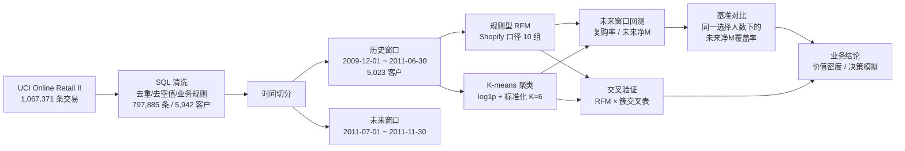
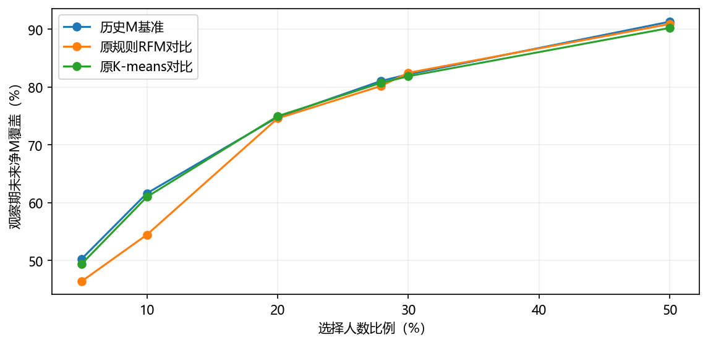

# 百万级电商用户分层与未来价值验证（MySQL + Python）

[](https://www.python.org/)
[](https://www.mysql.com/)
[](https://scikit-learn.org/)
[](LICENSE)
[](https://archive.ics.uci.edu/dataset/502/online+retail+ii)

> 基于 106 万条电商交易，用 **规则型 RFM（Shopify 口径）** 与 **K-means 聚类** 两套方法做用户分层，
> 并用 **5 个月未来窗口回测** + **基准对比** + **交叉验证** 检验"分层到底有没有用"。
> 项目不止于分群，更诚实地回答了那个常被回避的问题：**分群真的比"按金额排序"更会挑客户吗？**

---

## 📌 核心结论（先看这个）

| # | 结论 | 关键数字 |
|---|------|----------|
| 1 | ✅ 两套分层都能把未来价值**显著区分**（Kruskal-Wallis p < 0.001），复购率与人均未来消费呈清晰单调排序 | Champions 复购率 92.1%，Dormant 仅 21.0% |
| 2 | ⚠️ **分群没有超越基准**：相同选择人数下，"直接按历史金额排序"与两种分群的覆盖率几乎持平，分群不是更有效的预测工具 | η²：规则RFM 0.334 ≈ K-means 0.330 ≈ 单一历史金额 0.320 |
| 3 | 💡 分群的真正价值是**可解释、可运营**——"核心高价值客户"能直接映射营销动作，"按金额排序的第 300 名"不能 | 核心高价值+忠诚客户 27.9% 的人数贡献 80.2% 的未来净消费 |
| 4 | 🔍 K-means 的唯一实质增量在**组内细分**：Champions 内部高价值簇与次高簇差异极大 | 人均未来净M 5,613 vs 942（Mann-Whitney p < 0.0001） |
| 5 | 🧭 共线性是根因：F 与 M 高度相关（Spearman ρ = 0.847），RFM 实际接近二维，分群本质是历史金额的单调重排 | 想提升预测力，瓶颈在**补充特征**而非换模型 |

> 💬 这不是一个"证明分群有用"的项目，而是一个**用数据检验分群边界**的项目。
> 分析全流程坚持：分层只用历史窗口信息，未来窗口完全不参与建模，只用于回测。

---

## 🗺️ 项目全流程



**方法论要点**

- **规则型 RFM**：复刻 Shopify 官方口径 —— R/M 按分位数打 1~5 分，F 按频次分档（1 / 2 / 3–4 / 5–8 / 9+，因购买 1~2 次的用户占比极大），`FM = ⌊(F分 + M分)/2⌋`，再按 R × FM 映射为 11 个群组（本数据中"潜客"为空，实际 10 组）。
- **K-means**：特征为 R_days（距 2011-07-01 天数）、Frequency、Monetary；F/M 做 `log1p` 去长尾后 StandardScaler 标准化；经肘部法 + 轮廓系数 + 跨种子 ARI 稳定性检验，最终取 **K=6**（random_state=42, n_init=20，跨种子 ARI 0.9990~0.9994，六簇均 ≥ 472 人）。

---

## 📂 项目结构

```
GITHUB开源版/
├── README.md                          ← 你在这里
├── LICENSE                            MIT 许可证
├── requirements.txt                   Python 依赖（根目录）
├── 01_原始数据/
│   ├── README.md                      数据来源、字段说明、许可
│   └── online_retail_II.xlsx          UCI 原始数据（两个年度工作表）
├── 02_SQL脚本/                        MySQL 全链路（探索过程完整保留）
│   ├── 01_历史窗口_加载与清洗.sql      类型转换 → 清洗 → 建历史/未来表 → RFM打分 → Shopify分层
│   └── 02_未来窗口_与RFM分层与验证.sql 未来指标 → 分层回测 → 统计表 → 月度表现
├── 03_清洗与派生数据/                  代码的直接输入/输出（含 README 文件血缘说明）
│   ├── online_retail_ii_clean_history_rfm.csv        5,023 客户 × RFM得分×分组
│   ├── online_retail_ii_clean_history_rfm_statistics.csv   规则RFM各组历史画像
│   ├── online_retail_ii_customer_future_metrics.csv  5,023 客户未来指标
│   ├── online_retail_ii_customer_monthly_metrics.csv 客户×月度表现（25,115 行）
│   └── online_retail_ii_rfm_holdout_statistics.csv   规则RFM各组未来表现
├── 04_RFM与K-means分析/
│   └── K-means数据分析.ipynb          K选择 → 稳定性 → 六簇画像 → 未来验证 → 月度分析
├── 05_分析报告/
│   ├── 用户分层项目分析报告.html       ★ 最完整的离线报告（建议从这里开始读）
│   ├── 项目总结.md                    一页纸核心数字
│   ├── 代码审查报告.md                全量代码审查与复现验证记录
│   └── 图表/                          4 张核心图（分层表现 / 基准对比 / 交叉表）
└── 06_补充分析脚本/
    ├── 04_基准lift对比.py             公平 lift 对比 + η² + 显著性检验
    ├── 05_交叉验证.py                 复现 K-means + Champions×簇0 交叉单元
    └── requirements.txt
```

> ⚠️ 交易级明细 `online_retail_ii_clean.csv`（86 MB）与 `online_retail_ii_clean_holdout.csv`（23 MB）未随仓库分发（超出 GitHub 单文件 50MB 建议），它们是 SQL 脚本从 xlsx 的**确定性派生物**，运行一遍 `02_SQL脚本/01` 即可完整再生，详见 [03_清洗与派生数据/README.md](03_清洗与派生数据/README.md)。

---

## 🚀 快速开始

### 环境

- Python 3.11+（实测 pandas 3.0.5 / scikit-learn 1.9.0 可直接运行）
- MySQL 8.x（仅"全链路复现"路径需要）

```bash
git clone https://github.com/<你的用户名>/rfm-kmeans-customer-segmentation.git
cd rfm-kmeans-customer-segmentation
pip install -r requirements.txt
```

### 路径 A：只想看结论（0 依赖）

用浏览器打开 **[05_分析报告/用户分层项目分析报告.html](05_分析报告/用户分层项目分析报告.html)**，
或看一页纸的 **[05_分析报告/项目总结.md](05_分析报告/项目总结.md)**。

### 路径 B：复现 Python 分析（✓ 推荐，无需数据库）

数据文件已全部就位，两条脚本在任意工作目录下都能自动定位数据：

```bash
python 06_补充分析脚本/04_基准lift对比.py    # 公平lift对比 + η² + Kruskal-Wallis/Mann-Whitney
python 06_补充分析脚本/05_交叉验证.py        # K-means复现 + 交叉表 + Champions×簇0
```

Notebook 同理：在项目目录内启动 Jupyter 打开 `04_RFM与K-means分析/K-means数据分析.ipynb`，
路径自动向上查找数据目录，直接 Restart & Run All 即可。

### 路径 C：全链路复现（MySQL）

1. 将 `01_原始数据/online_retail_II.xlsx` 两个工作表导入 MySQL 库 `uci_new` 的 `online_retail_ii` 表（DataGrip / MySQL Workbench 导入向导均可）；
2. 依次执行 `02_SQL脚本/01_历史窗口_加载与清洗.sql` → `02_SQL脚本/02_未来窗口_与RFM分层与验证.sql`（按代码块顺序执行）；
3. 脚本将依次产出清洗表、RFM 原始表、Shopify 分层表与各组统计表，与 `03_清洗与派生数据/` 中的 CSV 一一对应。

**统一口径**：历史窗口 2009-12-01～2011-06-30，未来窗口 2011-07-01～2011-11-30；金额单位 GBP；
未来净额包含取消（C 发票）相关负金额；R 取最近一次**非取消**发票日期。

---

## 📊 关键结果

### 规则型 RFM：10 组人群的未来表现（节选）

| 人群 | 客户数 | 客户占比 | 复购率 | 人均未来净M(GBP) | 未来净M占比 | 价值密度* |
|------|-------:|-------:|-------:|-------:|-------:|-------:|
| Champions核心高价值客户 | 619 | 12.3% | 92.1% | 3,311 | **56.2%** | **4.56** |
| Loyal忠诚客户 | 781 | 15.5% | 79.3% | 1,121 | 24.0% | 1.54 |
| Active活跃客户 | 665 | 13.2% | 59.9% | 416 | 7.6% | 0.57 |
| Dormant休眠客户 | 1,508 | 30.0% | 21.0% | 88 | 3.6% | 0.12 |
| Previously loyal曾经忠诚客户 | 20 | 0.4% | 30.0% | **-57**（负） | -0.03% | -0.08 |

*价值密度 = 未来净M占比 ÷ 客户占比，> 1 表示贡献超过人数占比。完整 10 组见 [报告](05_分析报告/用户分层项目分析报告.html)。

### K-means 六簇 vs 基准：覆盖曲线



在 5%~50% 的每个选择比例下，"历史金额排序"基准与 K-means 几乎重合、规则 RFM 在低比例段落后
（10% 选择时 0.545 vs 0.616）——直观呈现了结论 2。

### 交叉验证：Champions × 原簇 0

| 指标 | 数值 |
|------|-----:|
| 交叉单元人数 | 314（占历史客户 6.25%） |
| 未来净M占比 | **48.30%** |
| 人均净M相对全体 | **7.73 倍** |
| 复购率 | 96.82% |
| 相同人数事后最优名单覆盖率 | 78.66% |

---

## 📈 复现对照表

| 数字 | 出处 | 一键复现 |
|------|------|----------|
| 轮廓系数 0.343 / 跨种子 ARI 0.9990~0.9994 | Notebook + 项目总结 | `python 06_补充分析脚本/04_基准lift对比.py` |
| 20% 名单覆盖：K-means 74.96% vs 基准 74.78% | 项目总结 | 同上 |
| η²：0.334 / 0.330 / 0.320 | 报告 05 节 | 同上 |
| Champions×簇0：314 人 / 48.30% / 7.73 倍 / 96.82% / 78.66% | 项目总结 | `python 06_补充分析脚本/05_交叉验证.py` |
| 规则RFM各组历史/未来统计 | SQL 两脚本 | 路径 C |

全部脚本输出已由代码审查在 pandas 3.0.5 + scikit-learn 1.9.0 环境下逐项核对通过，详见 [05_分析报告/代码审查报告.md](05_分析报告/代码审查报告.md)。

---

## ⚠️ 结论边界与局限（务必与结论一起阅读）

- **窗口不对称**：历史 19 个月 vs 未来 5 个月，金额水平不可直接比较，只看排序与相对强弱。
- **预测 ≠ 增量**：预测"更可能消费"不等于"对触达反应更大"，运营动作的增量效果必须通过 A/B 实验验证，本项目所有业务建议均为优先级假设。
- **F 评分偏离标准口径**：Shopify 三维均用分位数，本项目 F 采用固定频次分档，属业务化选择。
- **同源特征**：规则 RFM 与 K-means 使用同一套历史特征，二者交叉一致不构成独立验证。
- **小样本单元**：Previously loyal 仅 20 人且未来净消费为负；交叉表存在 n < 30 的单元，不可外推。
- **聚类边界重叠**：轮廓系数 0.343 属中等水平，不宜宣称"簇分得很开"。

**后续方向**：补充品类多样性、退货率、渠道来源、购买间隔趋势等特征（突破 η² ≈ 0.33 上限的关键在特征而非模型）→ 多切分点稳健性矩阵 → 再评估 XGBoost 等监督模型。

---

## 📄 许可与引用

- 代码：[MIT License](LICENSE)
- 数据：[UCI Online Retail II](https://archive.ics.uci.edu/dataset/502/online+retail+ii)（CC BY 4.0），引用请注明：

> Chen, S., Sain, S. L., & Guo, K. (2012). Data mining for the online retail industry: A case study of RFM model-based customer segmentation using data mining. *Journal of Database Marketing & Customer Strategy Management*, 19(3), 197–208.
